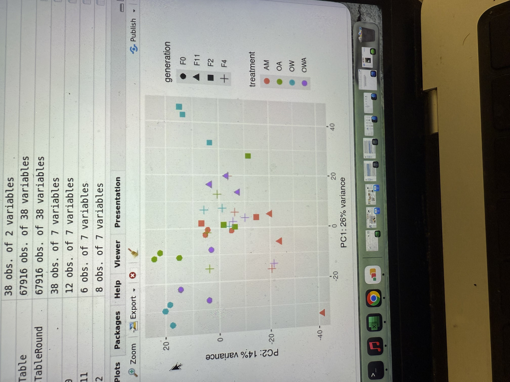

# Transcriptomics Notebook

**Course:** Into to Ecological Genomics Fall 2026

**Name:** Kai Roberts-Speaker

------------------------------------------------------------------------

## 9/15/2026 - Setting up Lab Notebook and Setting up Markdown

-   Setting up transcriptomics notebook

-   Learn to make notes in markdown

-   Push notes to github

    **Working Directory**

    `/gpfs1/home/k/i/kirobert/Projects/eco_genomics_2026/transcriptomics`

    **Input Files**

    `none`

    **Output Files**

    `gpfs1/home/k/i/kirobert/Projects/eco_genomics_2026/transcriptomics/TRANSCRIPTOMICS_NOTEBOOK.md`

    **Programs and Dependenceis**

-   `R Version 4.5.1`

-   `R Studio`

    **Scripts**

-   `none`

    **Code**

    `` the usage of ##_before words determines what size font will be produced, where more hashtags imply  a smaller size. **_** around words will bold them. *** will create a line. /table will create a table /image will allow import of an image. `_` will create a textbowx ``

**Table**

| Col1 | Col2 | Col3                    |
|------|------|-------------------------|
|      |      |                         |
|      |      |                         |
|      |      |  |

------------------------------------------------------------------------

# Transcriptomics Notebook

**Course:** Into to Ecological Genomics Fall 2026

**Name:** Kai Roberts-Speaker

------------------------------------------------------------------------

## 9/17/2026 Learning to use Commands on the Vacc Linux Server

-   Set path to enter the "cl" directory, before navigating to the "biol3990" and subsequently "Transcriptomics" folders and opening the "CleanData" directory which contains cleaned RNAseq data files in fq.gz form

-   Use commands ll and ls to list the detailed and simplified contents of a directory

-   use command "zcat ..." (where ... is a .gz) file to read and \| to send output to command "head -n 4" to read the first 4 lines of file contents

-   **Working Directory**

    `/gpfs1/cl/biol3990/Transcriptomics/CleanData`

    **Input Files**

    `AA_F0_Rep1_2_clean.fq.gz`

    **Output Files**

    `none`

    **Programs and Dependenceis**

-   `VACC Linux Server`

-   `Bash`

    **Scripts**

-   `none`

    **Code**

    ```         
    cd /gpfs1/cl/biol3990 to set working directory to biol3990

    cd Transcriptomics to enter transcriptomics

    ll to view the contents of a directory and info about said directory incluiding ownership and size

    ls to list contents of the directory 

    command zcat ...gz to uncompress a .gz file

    ... | ... to send the command to the following function (pipe)

     "head" begins reading from the start of the file

    -n 4 to quantify reading the first 4 lines of the file so
    zcat AA_F0_Rep1_2_clean.fq.gz | head -n 4 will read and display the first 4 lines of the F0_Rep1_2_clean.fq.gz file


    zcat...gz | wc -l  where the data in the  unzipped file is analyzed  by the "word count" command which is modified as wc -l where -l implies quantifying the number of lines. Output represents 4x number of reads as each read contains 4 lines
    ```

------------------------------------------------------------------------

# Transcriptomics Notebook

**Course:** Into to Ecological Genomics Fall 2026

**Name:** Kai Roberts-Speaker

------------------------------------------------------------------------

## 9/22/2026 Setting up Rstudio Work Environment

-   update .gitignore to exclude transcriptomics/mydata

-   move data from Vacc class Transcriptomics folder to personal transcriptomics folder

-   Create R script to perform intial manipulations and analyses of data

-   **Working Directory**

    `/gpfs1/cl/biol3990/Transcriptomics/CountsMatrix`

    `/gpfs1/home/k/i/kirobert/Projects/eco_genomics_2026/transcriptomics`

    **Input Files**

    `/gpfs1/home/k/i/kirobert/Projects/eco_genomics_2026/transcriptomics/mydata/salmon.isoform.counts.matrix.filteredAssembly`

-   `/gpfs1/home/k/i/kirobert/Projects/eco_genomics_2026/transcriptomics/mydata/ahud_samples_R.txt`

    **Programs and Dependenceis**

-   `VACC Linux Server`

-   `Bash`

-   `R Studio`

-   `DEseq`

    **Scripts**

-   `/gpfs1/home/k/i/kirobert/Projects/eco_genomics_2026/transcriptomics/myscripts/ahud_DEseq_inclass.R`

    **Code**

-   `cp * ~/projects/eco_genomics_2026/transcriptomics/mydata`

    #cp (copy) \* (wildcard=anything in directory) \~/projects/eco_genomics_2026/transcriptomics/mydata (gives path to where you want to copy file

-   in \~/Projects/eco_genomics_2026/.gitignore add `./transcriptomics/mydata` to exclude datafiles from being pushed to github, then stage,commit,and push that function `git add .gitignore git commit -m "Ignore results directory" git push`

\`\``## to verify this, add a .txt file in mydata using bash command`touch ./mydata/test.txt`, before checking in terminal`git status\`. If this file dosent shows up in command output, inclusion to .gitignore worked

{width="364"}

this image was imported using ` scp /Users/kairoberts-speaker/Desktop/IMG_1152.jpg kirobert@login.vacc.uvm.edu:/gpfs1/home/k/i/kirobert/Projects/eco_genomics_2026/transcriptomics/images` which was run on laptop terminal

------------------------------------------------------------------------

# Transcriptomics Notebook

**Course:** Into to Ecological Genomics Fall 2026

**Name:** Kai Roberts-Speaker

------------------------------------------------------------------------

## 9/24/2026 Basic R tutorial

-   Define Objects

-   simple statistics

-   get readouts of data contents and data type

-   **Working Directory**

    `/~/Projects/eco_genomics_2026_transcriptomics`

    **Input Files**

    `None`

    **Output Files**

    `none`

    **Programs and Dependenceis**

-   `R Studio`

    **Scripts**

-   `~/Projects/eco_genomics_2026/transcriptomics/practice_r_transcriptomics.R`

    **Code**

    ```         
    x <- 5 define x as 5
    students <- data.frame(
      name = c("A","B","C"),
      height = c(62,68,72)
    )    use function data.frame to define a matrix of variables, and call it students. Parenthasize each component part. Use quotation marks around non numeric values. 
    head(students)  Readout of "students " from top
    class(students) reports the data type of students, i.e. data.frame
    str(students) resports the value types; numerical or character 

    students$name[2] reports value from collumn 2 of names set

    mean(students$height) performs mean calculation of student height 
    ```

------------------------------------------------------------------------

# 
