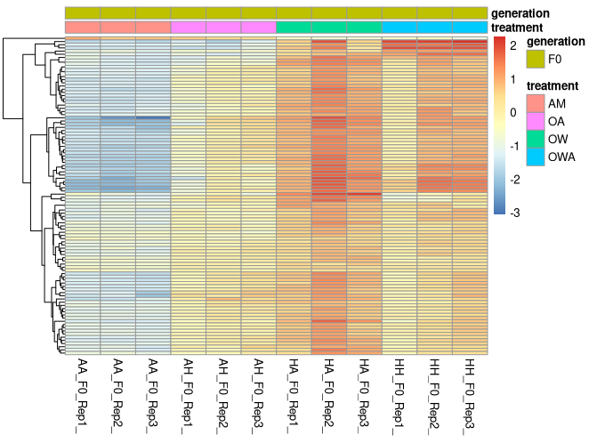
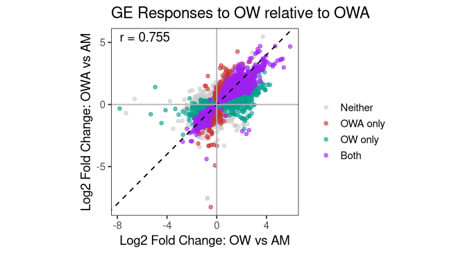

# Transcriptomics Notebook

**Course:** Into to Ecological Genomics Fall 2026

**Name:** Kai Roberts-Speaker

------------------------------------------------------------------------

## 9/15/2026 - Setting up Lab Notebook and Setting up Markdown

-   Setting up transcriptomics notebook

-   Learn to make notes in markdown

-   Push notes to github

    **Working Directory**

    `/gpfs1/home/k/i/kirobert/Projects/eco_genomics_2026/transcriptomics`

    **Input Files**

    `none`

    **Output Files**

    `gpfs1/home/k/i/kirobert/Projects/eco_genomics_2026/transcriptomics/TRANSCRIPTOMICS_NOTEBOOK.md`

    **Programs and Dependenceis**

-   `R Version 4.5.1`

-   `R Studio`

    **Scripts**

-   `none`

    **Code**

    `` the usage of ##_before words determines what size font will be produced, where more hashtags imply  a smaller size. **_** around words will bold them. *** will create a line. /table will create a table /image will allow import of an image. `_` will create a textbowx ``

**Table**

| Col1 | Col2 | Col3                    |
|------|------|-------------------------|
|      |      |                         |
|      |      |                         |
|      |      |  |

------------------------------------------------------------------------

## 9/17/2026 Learning to use Commands on the Vacc Linux Server

-   Set path to enter the "cl" directory, before navigating to the "biol3990" and subsequently "Transcriptomics" folders and opening the "CleanData" directory which contains cleaned RNAseq data files in fq.gz form

-   Use commands ll and ls to list the detailed and simplified contents of a directory

-   use command "zcat ..." (where ... is a .gz) file to read and \| to send output to command "head -n 4" to read the first 4 lines of file contents

-   **Working Directory**

    `/gpfs1/cl/biol3990/Transcriptomics/CleanData`

    **Input Files**

    `AA_F0_Rep1_2_clean.fq.gz`

    **Output Files**

    `none`

    **Programs and Dependenceis**

-   `VACC Linux Server`

-   `Bash`

    **Scripts**

-   `none`

    **Code**

    ```         
    cd /gpfs1/cl/biol3990 to set working directory to biol3990

    cd Transcriptomics to enter transcriptomics

    ll to view the contents of a directory and info about said directory incluiding ownership and size

    ls to list contents of the directory 

    command zcat ...gz to uncompress a .gz file

    ... | ... to send the command to the following function (pipe)

     "head" begins reading from the start of the file

    -n 4 to quantify reading the first 4 lines of the file so
    zcat AA_F0_Rep1_2_clean.fq.gz | head -n 4 will read and display the first 4 lines of the F0_Rep1_2_clean.fq.gz file


    zcat...gz | wc -l  where the data in the  unzipped file is analyzed  by the "word count" command which is modified as wc -l where -l implies quantifying the number of lines. Output represents 4x number of reads as each read contains 4 lines
    ```

------------------------------------------------------------------------

## 9/22/2026 Setting up Rstudio Work Environment

-   update .gitignore to exclude transcriptomics/mydata

-   move data from Vacc class Transcriptomics folder to personal transcriptomics folder

-   Create R script to perform intial manipulations and analyses of data

-   **Working Directory**

    `/gpfs1/cl/biol3990/Transcriptomics/CountsMatrix`

    `/gpfs1/home/k/i/kirobert/Projects/eco_genomics_2026/transcriptomics`

    **Input Files**

    `/gpfs1/home/k/i/kirobert/Projects/eco_genomics_2026/transcriptomics/mydata/salmon.isoform.counts.matrix.filteredAssembly`

-   `/gpfs1/home/k/i/kirobert/Projects/eco_genomics_2026/transcriptomics/mydata/ahud_samples_R.txt`

    **Programs and Dependenceis**

-   `VACC Linux Server`

-   `Bash`

-   `R Studio`

-   `DEseq2`

    **Scripts**

-   `/gpfs1/home/k/i/kirobert/Projects/eco_genomics_2026/transcriptomics/myscripts/ahud_DEseq_inclass.R`

    **Code**

-   `cp * ~/projects/eco_genomics_2026/transcriptomics/mydata`

    #cp (copy) \* (wildcard=anything in directory) \~/projects/eco_genomics_2026/transcriptomics/mydata (gives path to where you want to copy file

-   in \~/Projects/eco_genomics_2026/.gitignore add `./transcriptomics/mydata` to exclude datafiles from being pushed to github, then stage,commit,and push that function `git add .gitignore git commit -m "Ignore results directory" git push`

\`\``## to verify this, add a .txt file in mydata using bash command`touch ./mydata/test.txt`, before checking in terminal`git status\`. If this file dosent shows up in command output, inclusion to .gitignore worked

{width="364"}

this image was imported using ` scp /Users/kairoberts-speaker/Desktop/IMG_1152.jpg kirobert@login.vacc.uvm.edu:/gpfs1/home/k/i/kirobert/Projects/eco_genomics_2026/transcriptomics/images` which was run on laptop terminal

------------------------------------------------------------------------

## 9/24/2026 Basic R tutorial

-   Define Objects

-   simple statistics

-   get readouts of data contents and data type

-   **Working Directory**

    `/~/Projects/eco_genomics_2026_transcriptomics`

    **Input Files**

    `None`

    **Output Files**

    `none`

    **Programs and Dependenceis**

-   `R Studio`

    **Scripts**

-   `~/Projects/eco_genomics_2026/transcriptomics/practice_r_transcriptomics.R`

    **Code**

    ```         
    x <- 5 define x as 5
    students <- data.frame(
      name = c("A","B","C"),
      height = c(62,68,72)
    )    use function data.frame to define a matrix of variables, and call it students. Parenthasize each component part. Use quotation marks around non numeric values. 
    head(students)  Readout of "students " from top
    class(students) reports the data type of students, i.e. data.frame
    str(students) resports the value types; numerical or character 

    students$name[2] reports value from collumn 2 of names set

    mean(students$height) performs mean calculation of student height 
    ```

------------------------------------------------------------------------

## 9/29/2026 DEseq day 2

-   Analyze F0 data from the counts matrix data

-   Model differential regulation (up/down) using DEseq2 package commands to generate datapoints, dplyr to wrangle data, and pheatmap/eulerr packages to plot data

-   **Working Directory**

    `/gpfs1/home/k/i/kirobert/Projects/eco_genomics_2026/transcriptomics/mydata`

    **Input Files**

    `/gpfs1/home/k/i/kirobert/Projects/eco_genomics_2026/transcriptomics/mydata/salmon.isoform.counts.matrix.filteredAssembly`

-   `/gpfs1/home/k/i/kirobert/Projects/eco_genomics_2026/transcriptomics/mydata/ahud_samples_R.txt`

    **Programs and Dependenceis**

-   `R Studio`

-   `DEseq2`

    **Scripts**

-   ``` /gpfs1/home/k/i/kirobert/Projects/eco_genomics_2026/transcriptomics/myscripts/``9.29.2026_AHUD_DEseq_inclass2.R ```

    **Code**

-   `DESeqDataSetFromMatrix   (to define object from counts matrix/metadata) DESeq(run DE comparison)  plotMA(logfold 2 change mean) counts(display raw count matrix data)  plotCounts(plot counts across genes)mutate(add variabvle) pheatmap(plot heatmaps) euler(generate euler comparison)   plot(draw euler) upset(plot upset)`

{width="137"}

{width="235"}

{width="242"}

------------------------------------------------------------------------

## 10/1/2026 DEseq day 3

-   Correlate comparative Datasets and define new variable of comparison output with Mutate function

-   Plot these data on scatter plot in ggplot package commands

-   **Working Directory**

    `/gpfs1/home/k/i/kirobert/Projects/eco_genomics_2026/transcriptomics/mydata`

    **Input Files**

    `/gpfs1/home/k/i/kirobert/Projects/eco_genomics_2026/transcriptomics/mydata/salmon.isoform.counts.matrix.filteredAssembly`

-   `/gpfs1/home/k/i/kirobert/Projects/eco_genomics_2026/transcriptomics/mydata/ahud_samples_R.txt`

    **Programs and Dependenceis**

-   `VACC Linux Server`

-   `R Studio`

-   `DEseq2`

    **Scripts**

-   `/gpfs1/home/k/i/kirobert/Projects/eco_genomics_2026/transcriptomics/myscripts/9.29.2026_AHUD_DEseq_inclass2.R`

    **Code**

    `from manual using dplyr functions "filter() to remove rows mutate() to add a new variable case_when() to classify genes into categories arrange() to sort the rows". Also, merge to combine datasets defining perameter and mutate used to add new output value based on merged data to record significance across conditions`. `Defining plotting order by what you want ontop levels = c("x" , "y" , "z")`. `mereg() cor() coord_fixed() to generate comparison and to be able to compare like-to-like data. annotate() adds correlation value to graph`

-   

## 10/6/2026 GO Enrichment

-   Correlate comparative Datasets and define new variable of comparison output with Mutate function

-   Plot these data on scatter plot in ggplot package commands

-   **Working Directory**

    `/gpfs1/home/k/i/kirobert/Projects/eco_genomics_2026/transcriptomics/mydata`

    **Input Files**

    `/gpfs1/home/k/i/kirobert/Projects/eco_genomics_2026/transcriptomics/mydata/salmon.isoform.counts.matrix.filteredAssembly`

-   `/gpfs1/home/k/i/kirobert/Projects/eco_genomics_2026/transcriptomics/mydata/ahud_samples_R.txt`

-   `/gpfs1/home/k/i/kirobert/Projects/eco_genomics_2026/transcriptomics/mydata/trinotate_annotation_GOblastx_forTopGO.txt`

    ### Output Files

    `/gpfs1/home/k/i/kirobert/Projects/eco_genomics_2026/transcriptomics/mydata/myresults/GO_FO_OWvsAM_BP.csv`

    `/gpfs1/home/k/i/kirobert/Projects/eco_genomics_2026/transcriptomics/mydata/myresults/GO_FO_OAvsAM_BP.csv`

    `/gpfs1/home/k/i/kirobert/Projects/eco_genomics_2026/transcriptomics/mydata/myresults/GO_FO_OWAvsAM_BP.csv`

-   **Programs and Dependenceis**

-   `VACC Linux Server`

-   `R Studio`

-   `DEseq2`

-   topGO

    **Scripts**

-   `/gpfs1/home/k/i/kirobert/Projects/eco_genomics_2026/transcriptomics/myscripts/GOday1_10_6_2026.R`

    **Code**

    `read.csv()to load DESeq2 results strsplit(..., "::") + paste(x[1:2]) shorten transcript IDs to shortID for GO matching write.csv() to generate file to export readMappings() perform gene/GO file table(unlist(geneID2GO)) to count genes per GO term keepTerms <- allGO >= 5 & allGO <= 500 filter genes new("topGOdata", ontology = "BP", ...) to build topGO object runTest(algorithm = "weight01", "fisher") performs enrichment test GenTable(topNodes = 100) to display top enriched terms arrange(weightFisher) + slice(1:10) to select top 10 terms ggplot() + ge`om_point()+ scale_color_viridis_c() → bubble plot (x = −log10 p, size = genes, color = −log10 p)\`

    ## 10/8/2026 WGCNA 

<!-- -->

-   Correlate comparative Datasets and define new variable of comparison output with Mutate function

-   Plot these data on scatter plot in ggplot package commands

-   **Working Directory**

    `/gpfs1/home/k/i/kirobert/Projects/eco_genomics_2026/transcriptomics/mydata`

    **Input Files**

    `/gpfs1/home/k/i/kirobert/Projects/eco_genomics_2026/transcriptomics/mydata/salmon.isoform.counts.matrix.filteredAssembly`

-   `/gpfs1/home/k/i/kirobert/Projects/eco_genomics_2026/transcriptomics/mydata/ahud_trait_data.txt`

    **Programs and Dependenceis**

-   `VACC Linux Server`

-   `R Studio`

-   `DEseq2`

-   WGCNA

    **Scripts**

-   `/gpfs1/home/k/i/kirobert/Projects/eco_genomics_2026/transcriptomics/myscripts/9.29.2026_WGCNA_HW.R`

    **Code**

`pickSoftThreshold(powerVector, "signed") to test candidate soft powers ggplot(SFT.R.sq) + geom_hline(yintercept=0.8)to pick lowest power with R² ≥ 0.8. soft_power <- 6 define selected power value temp_cor <- cor; cor <- WGCNA::cor to save base cor, mask with WGCNA cor blockwiseModules(TOMType="signed", the heart of it to build network, detect modules minModuleSize=30, mergeCutHeight=0.25) chooseTopHubInEachModule(type="signed") will find hub gene per module unique(shortID[colors == "yellow"]) to condense yellow module genes`
